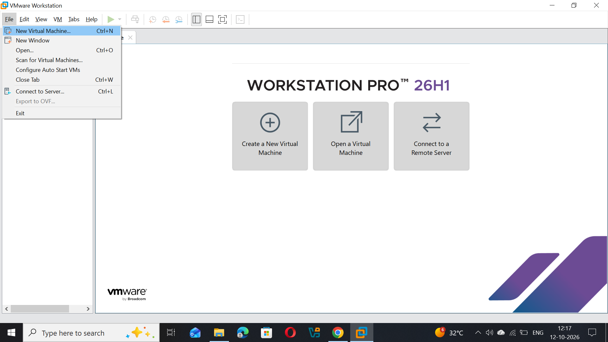
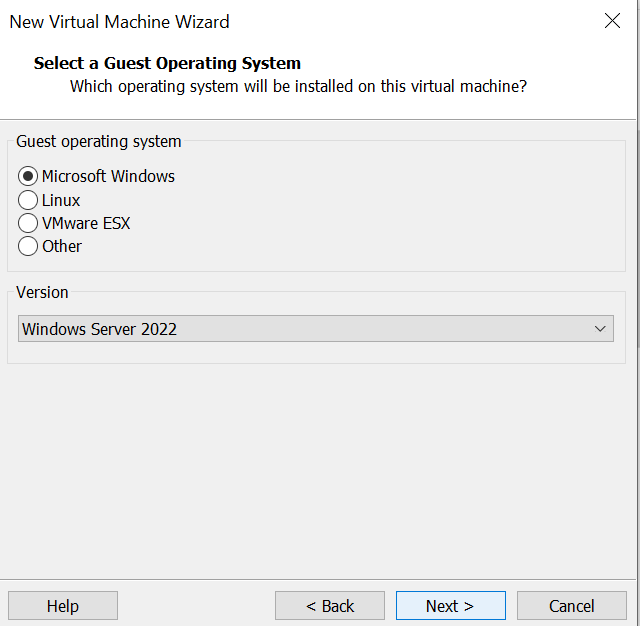
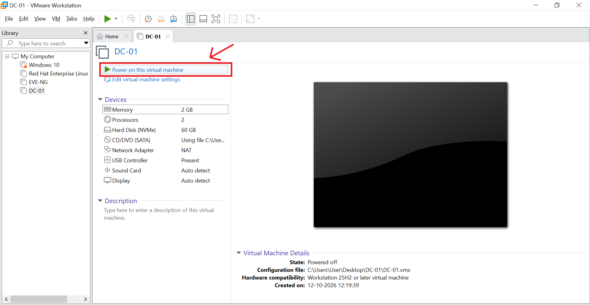
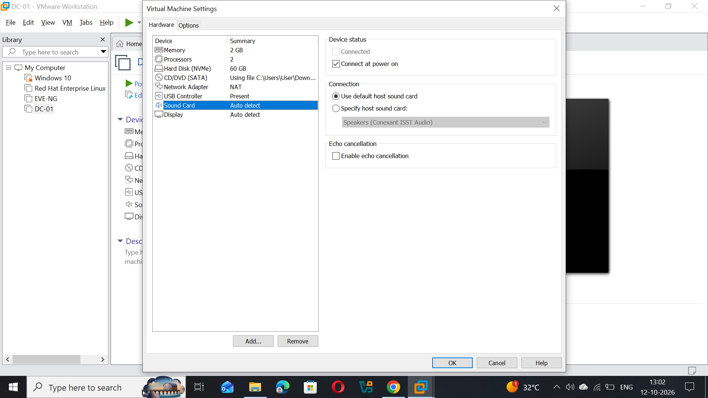
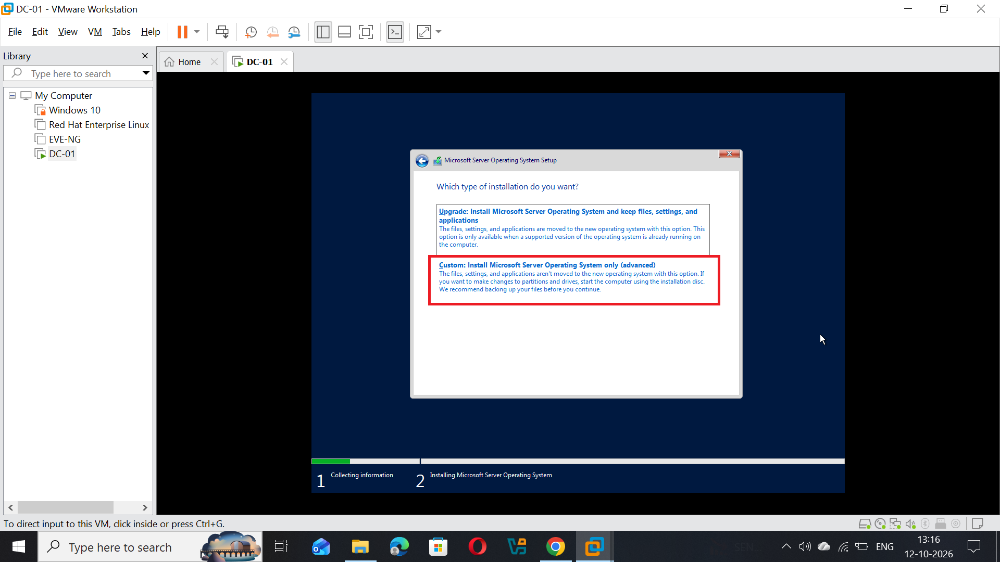
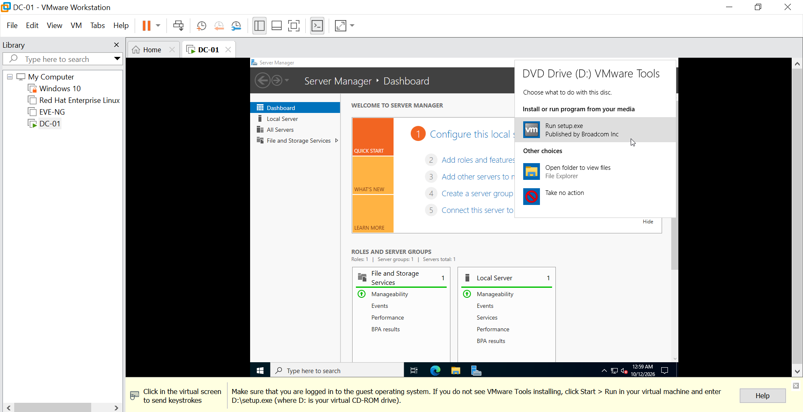
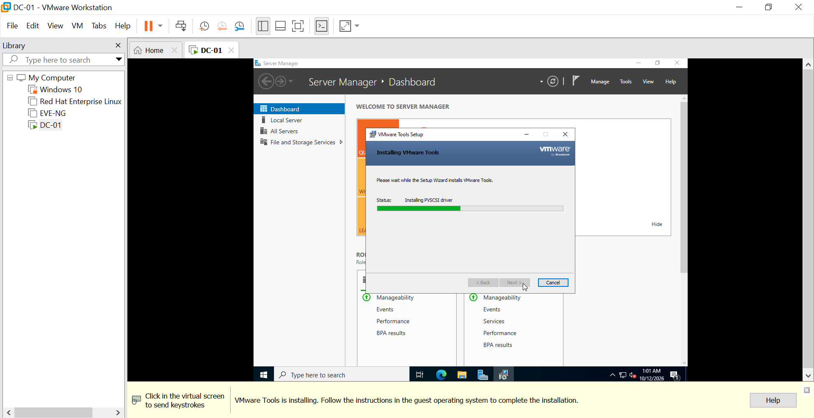
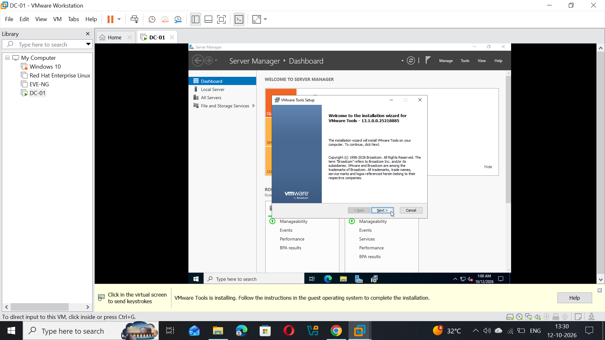

# Lab 1: Installing Windows Server on VMware Workstation

## 🎯 Objective

- Create a virtual machine in VMware Workstation.
- Install Windows Server 2022.
- Prepare the server that will be configured as the domain controller in later labs.

## 🖥️ Lab Environment

- 💿 **Virtualization Platform:** VMware Workstation
- 🪟 **Operating System:** Windows Server 2022
- 🏷️ **Virtual Machine Name:** DC-01
- 🎯 **Purpose:** Prepare the Windows Server virtual machine for the Active Directory homelab.

## 📘 Theory

### What Is Windows Server?

Windows Server is Microsoft's server operating system, designed to provide centralized services and resources across a network. It supports server roles and features such as Active Directory Domain Services (AD DS), DNS, DHCP, file services, and remote access. Administrators install the operating system first and then configure the required roles according to the needs of the environment.

### What Is Virtualization?

Virtualization allows multiple isolated virtual computers to run on a single physical computer. Each virtual machine (VM) is provided with virtual hardware resources such as CPU, memory, storage, and network adapters. This makes it possible to build and practice with a server environment without requiring a separate physical machine for every server.

### What Is VMware Workstation?

VMware Workstation is a desktop virtualization platform that runs virtual machines on a host computer. It provides the virtual hardware and controls needed to create, configure, start, stop, and manage VMs. In this lab, VMware Workstation hosts the Windows Server 2022 virtual machine named `DC-01`.

### What Is an ISO Image?

An ISO image is a file that contains the contents of an installation disc. A Windows Server ISO can be connected to a virtual machine as virtual installation media. The VM can then boot from that media and run Windows Setup to install the operating system on its virtual disk.

### Why Is This Installation Important?

Installing Windows Server is the foundation for the remaining Active Directory homelab. In this lab, the goal is only to create the `DC-01` virtual machine and install Windows Server 2022. Active Directory Domain Services, domain creation, DNS configuration, and domain controller promotion are handled in the following lab.

---

## ⚙️ Lab Configuration

### Step 1: Create the Virtual Machine

1. Open VMware Workstation.
2. Create a new virtual machine.
3. Select the Windows Server installation media and configure the virtual machine.
4. Name the virtual machine `DC-01`.
5. Review the virtual machine configuration before starting it.

**📸 Screenshot — Virtual machine setup**

### Step 2: Install Windows Server

1. Start the `DC-01` virtual machine.
2. Boot from the Windows Server installation media.
3. Follow the Windows Setup prompts to proceed with the installation.
4. Allow Windows Server to complete the installation process.

**📸 Screenshot — Windows Server installation**

### Step 3: Complete Initial Setup

1. Complete the remaining Windows Server setup prompts.
2. Sign in to the newly installed server.
3. Confirm that the `DC-01` virtual machine starts and Windows Server is accessible.
4. Keep this server ready for the Active Directory Domain Services configuration in Lab 2.

**📸 Screenshot — Installed server and initial environment**

## ✅ Expected Result

- Windows Server 2022 is installed in VMware Workstation.
- The virtual machine is named `DC-01`.
- The server starts successfully and is ready for the next lab.

## 📌 Outcome

Successfully installed Windows Server in a VMware Workstation virtual machine named **DC-01**. This server will be configured with Active Directory Domain Services in Lab 2.

## 🙏 Acknowledgment

This lab is part of my hands-on Active Directory homelab learning journey. Thank you for reviewing my documentation.

## ✍️ Author's Note

The screenshots for this lab are stored in the `screenshots` folder. Only selected milestone screenshots are embedded in this README to keep the instructions readable; the existing screenshot files are preserved in the repository.
