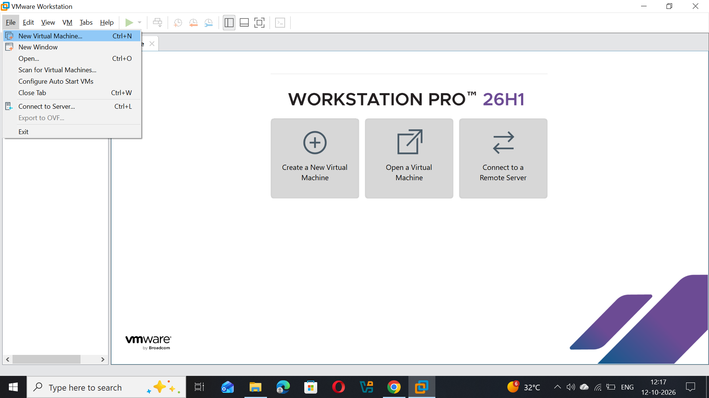
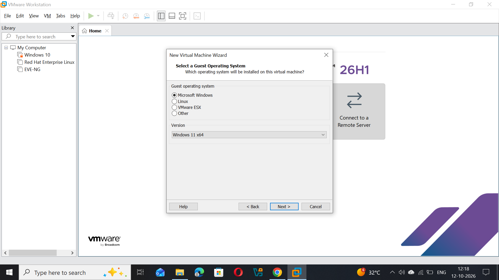
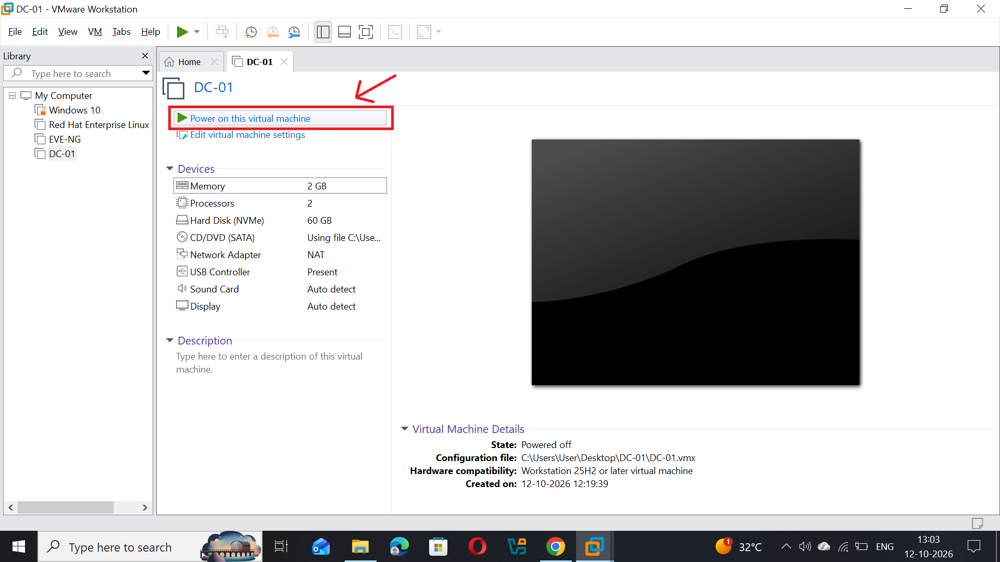
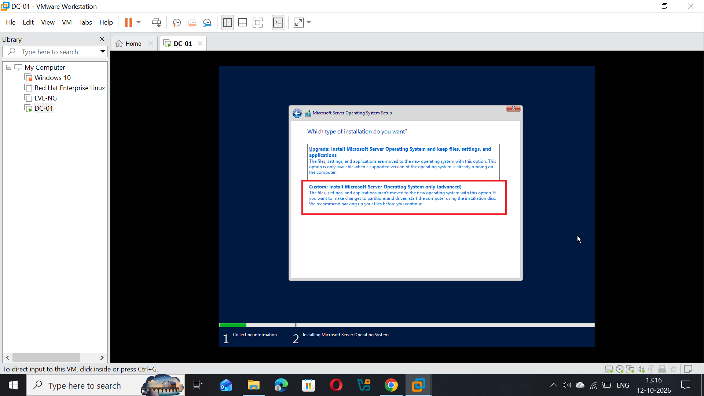
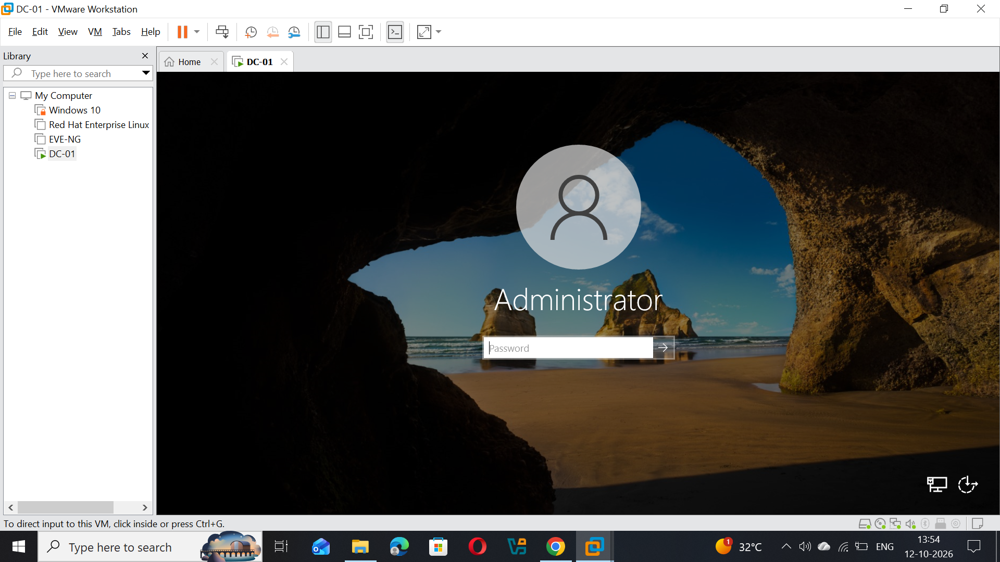
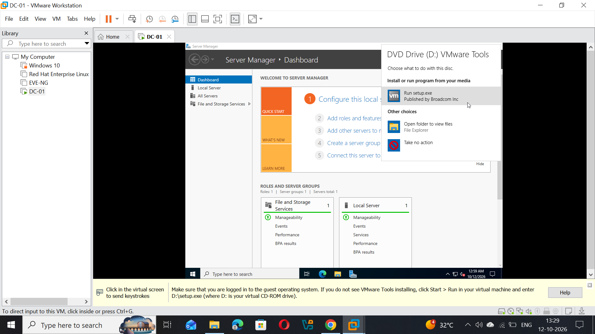
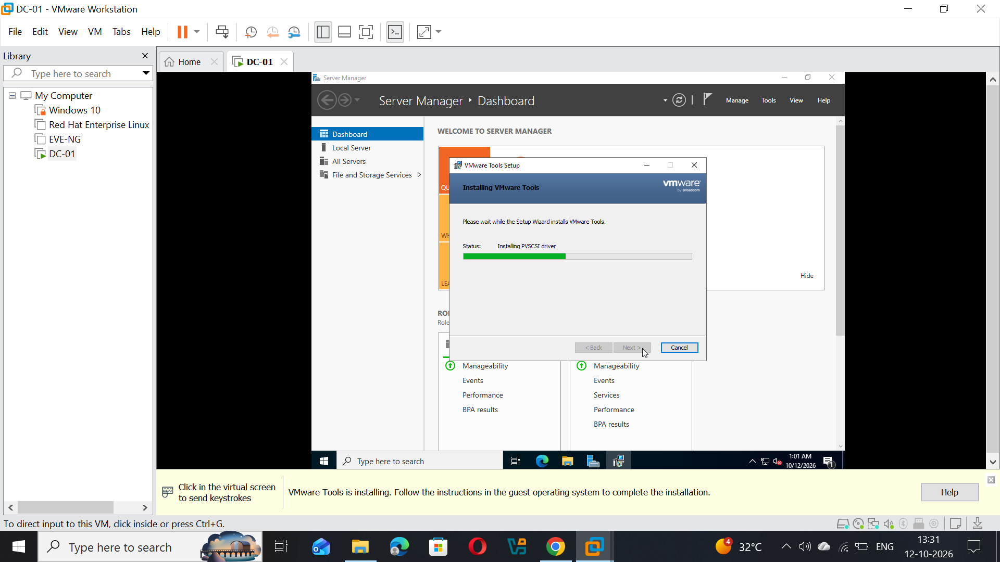
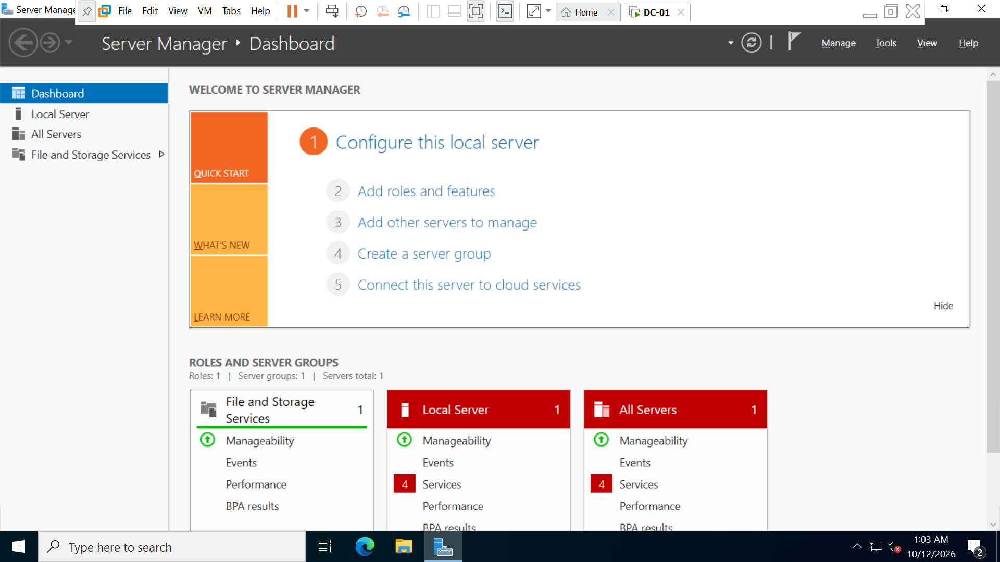

# Lab 1: Installing Windows Server on VMware Workstation

## 🎯 Objective

- Create a virtual machine in VMware Workstation.
- Install Windows Server 2022.
- Prepare the server that will be configured as the domain controller in later labs.

## 🖥️ Lab Environment

- 💿 **Virtualization Platform:** VMware Workstation
- 🪟 **Operating System:** Windows Server 2022
- 🏷️ **Virtual Machine Name:** DC-01
- 🎯 **Purpose:** Prepare the Windows Server virtual machine for the Active Directory homelab.

## ⚙️ Lab Configuration

### Step 1: Create the Virtual Machine

1. Open VMware Workstation.
2. Create a new virtual machine.
3. Select the Windows Server installation media and configure the virtual machine.
4. Name the virtual machine `DC-01`.
5. Review the virtual machine configuration before starting it.

**📸 Screenshot — Virtual machine setup**

### Step 2: Install Windows Server

1. Start the `DC-01` virtual machine.
2. Boot from the Windows Server installation media.
3. Follow the Windows Setup prompts to proceed with the installation.
4. Allow Windows Server to complete the installation process.

**📸 Screenshot — Windows Server installation**

### Step 3: Complete Initial Setup

1. Complete the remaining Windows Server setup prompts.
2. Sign in to the newly installed server.
3. Confirm that the `DC-01` virtual machine starts and Windows Server is accessible.
4. Keep this server ready for the Active Directory Domain Services configuration in Lab 2.

**📸 Screenshot — Installed server and initial environment**

## ✅ Expected Result

- Windows Server 2022 is installed in VMware Workstation.
- The virtual machine is named `DC-01`.
- The server starts successfully and is ready for the next lab.

## 📌 Outcome

Successfully installed Windows Server in a VMware Workstation virtual machine named **DC-01**. This server will be configured with Active Directory Domain Services in Lab 2.

## 🙏 Acknowledgment

This lab is part of my hands-on Active Directory homelab learning journey. Thank you for reviewing my documentation.

## ✍️ Author's Note

The screenshots for this lab are stored in the `screenshots` folder. Only selected milestone screenshots are embedded in this README to keep the instructions readable; the existing screenshot files are preserved in the repository.
