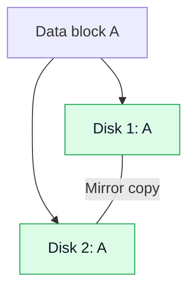
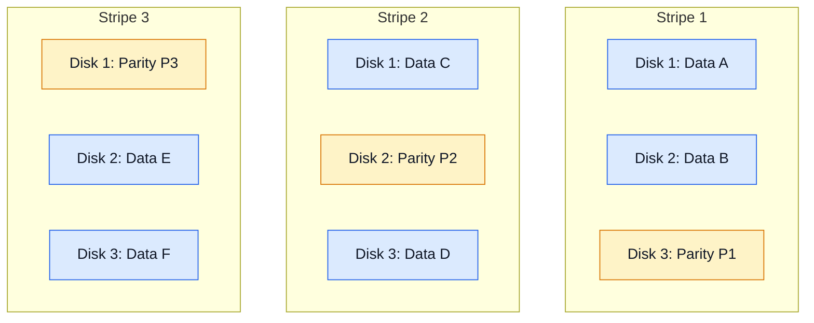
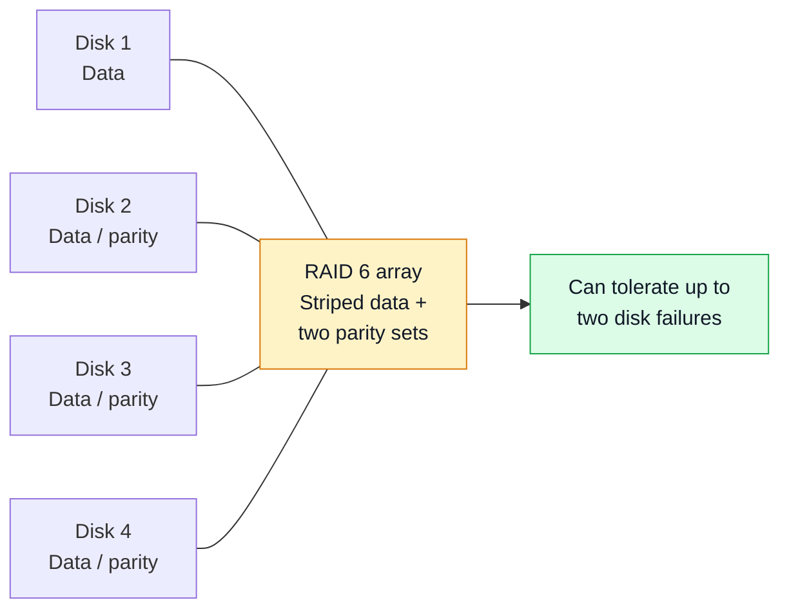
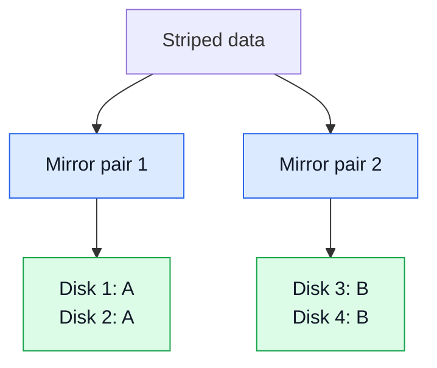

# Lab 18: RAID Concepts

## 🎯 Objective

Understand **Redundant Array of Independent Disks (RAID)**, how common RAID levels organize data, and how they compare in usable capacity, performance, and fault tolerance. This is a theory-focused lab that prepares for practical configuration in Lab 19.

## 🧪 Lab Environment

- **Hypervisor:** VMware Workstation
- **Operating System:** Windows Server 2022
- **Server:** `DC-01`
- **Tools:** Markdown diagrams and worked storage-capacity examples
- **Changes to disks:** None — this lab is conceptual and does not modify the server's disks

## 📘 RAID Fundamentals

RAID combines multiple physical disks into a logical storage arrangement. Depending on the RAID level, it can improve performance, provide redundancy, or balance capacity and fault tolerance.

Three ideas matter when choosing a RAID level:

- **Performance:** How quickly data can be read or written.
- **Redundancy / fault tolerance:** Whether the array can continue operating after one or more disk failures.
- **Usable capacity:** The amount of storage available for data after accounting for mirroring or parity.

> **Important:** RAID is not a backup. It does not protect against accidental deletion, ransomware, file corruption that is replicated, theft, or loss of the entire system. Maintain separate, tested backups.

## 🧩 RAID 0 — Striping

RAID 0 splits data into stripes and distributes them across at least two disks. It offers high performance and uses all disk capacity, but **has no redundancy**. If any member disk fails, the array's data is generally lost.

```mermaid
flowchart TB
    D[Data stream] --> S{Stripe data}
    S --> A[Disk 1: A1 | A3 | A5]
    S --> B[Disk 2: A2 | A4 | A6]
    style A fill:#dbeafe,stroke:#2563eb,color:#111827
    style B fill:#dbeafe,stroke:#2563eb,color:#111827
```

- **Minimum disks:** 2
- **Usable capacity:** `N × S`
- **Fault tolerance:** None
- **Best understood as:** Performance and capacity without protection against disk failure

## 🪞 RAID 1 — Mirroring

RAID 1 writes the same data to two or more disks in a mirror. In a two-disk mirror, one disk can fail while the remaining disk continues to provide the mirrored data, assuming the array and system remain healthy.



- **Minimum disks:** 2
- **Usable capacity:** Typically the capacity of one disk for a two-disk mirror
- **Fault tolerance:** A two-disk mirror can survive one member-disk failure
- **Trade-off:** Simple redundancy, but about half the raw capacity is usable with two equal-sized disks

## 🧮 RAID 5 — Striping with Distributed Parity

RAID 5 stripes data across at least three disks and distributes parity information among the members. Parity allows the array to reconstruct missing data after one disk fails.



- **Minimum disks:** 3
- **Usable capacity:** `(N − 1) × S`
- **Fault tolerance:** One disk failure
- **Trade-off:** Efficient capacity use, but writes require parity calculations; rebuilding after a failure can be lengthy and stressful for remaining disks

## 🛡️ RAID 6 — Striping with Dual Distributed Parity

RAID 6 is similar to RAID 5 but stores two independent sets of parity information. It can continue operating after two member disks fail, provided the array is otherwise healthy.



- **Minimum disks:** 4
- **Usable capacity:** `(N − 2) × S`
- **Fault tolerance:** Any two member-disk failures
- **Trade-off:** More protection than RAID 5, with capacity and write-performance overhead from the second parity set

## 🔗 RAID 10 (1+0) — Striping Across Mirrors

RAID 10 combines mirroring and striping. Disks are first organized into mirror pairs, and data is striped across those pairs. It requires at least four disks in a typical arrangement.



- **Minimum disks:** 4
- **Usable capacity:** Typically `(N ÷ 2) × S` with an even number of equal-sized disks
- **Fault tolerance:** Depends on which disks fail. It can survive multiple failures if they occur in different mirror pairs, but failure of both disks in the same pair causes data loss.
- **Trade-off:** Strong read/write performance and redundancy, at the cost of roughly half the raw capacity

## 📊 RAID Level Comparison

| RAID level | Minimum disks | Usable capacity* | Disk-failure tolerance | Main advantage | Main limitation |
|---|---:|---|---|---|---|
| **RAID 0** | 2 | `N × S` | None | Performance and full raw capacity | Any member failure can lose the array |
| **RAID 1** | 2 | Typically `S` for a two-disk mirror | One disk in a two-disk mirror | Simple mirroring | High capacity overhead |
| **RAID 5** | 3 | `(N − 1) × S` | One disk | Good capacity efficiency with redundancy | Parity-write overhead; only one disk of protection |
| **RAID 6** | 4 | `(N − 2) × S` | Two disks | Greater disk-failure tolerance | More capacity and write overhead |
| **RAID 10** | 4 | Typically `(N ÷ 2) × S` | Depends on failed mirror members | Performance plus mirroring | Uses about half of raw capacity |

`N` = number of member disks. `S` = capacity of the smallest member disk. These formulas assume equal-sized disks and a conventional implementation; actual usable capacity can be lower because of metadata, formatting, and implementation details.

## 🧮 Worked Capacity Example

Assume four equal-sized **2 TB** disks. Before formatting or metadata overhead:

| RAID level | Calculation | Approximate usable capacity |
|---|---|---:|
| RAID 0 | `4 × 2 TB` | 8 TB |
| RAID 1 | Two-way mirror using two disks | 2 TB per two-disk mirror |
| RAID 5 | `(4 − 1) × 2 TB` | 6 TB |
| RAID 6 | `(4 − 2) × 2 TB` | 4 TB |
| RAID 10 | `(4 ÷ 2) × 2 TB` | 4 TB |

**Note:** RAID 1 capacity depends on the number of disks and mirror layout. With four disks configured as two separate two-disk mirrors, each mirror has 2 TB usable; if all four disks form a four-way mirror, usable capacity is typically 2 TB. This example is for comparison, not a configuration recommendation.

## ⚙️ How RAID Can Be Implemented

- **Hardware RAID:** A dedicated controller manages the array. Available RAID levels and recovery features depend on the controller and its firmware.
- **Software RAID:** The operating system manages redundancy and data layout in software.
- **Windows Server Storage Spaces:** Pools eligible physical disks and creates virtual disks with supported resiliency layouts, such as simple, mirror, or parity. These are Storage Spaces resiliency types and should not automatically be treated as identical to every traditional hardware RAID implementation.

VMware Workstation virtual disks by themselves do not provide a physical RAID controller. For Lab 19, we will first check the available Windows Server and VMware options and select a supported, safe method.

## 🧠 Choosing a RAID Level

| Scenario | Concept to consider | Why |
|---|---|---|
| Temporary scratch data where loss is acceptable | RAID 0 | Capacity and performance, without redundancy |
| A simple two-disk mirrored data volume | RAID 1 | Straightforward protection against one member failure |
| Capacity efficiency with protection from one disk failure | RAID 5 | One disk's worth of capacity is used for parity |
| More protection against simultaneous disk failures | RAID 6 | Two disks' worth of capacity is used for parity |
| Performance and mirrored redundancy | RAID 10 | Combines striping with mirrored disk pairs |

The appropriate choice depends on workload, write behavior, performance targets, rebuild risk, capacity needs, controller or operating-system support, and recovery requirements. RAID alone does not guarantee availability.

## ⚠️ Important RAID Terms

- **Striping:** Splitting data into blocks and distributing them across disks.
- **Mirroring:** Keeping duplicate copies of data on separate disks.
- **Parity:** Redundant information used to reconstruct missing data.
- **Degraded array:** An array that has lost a member disk but is still operating.
- **Rebuild:** Reconstructing redundancy onto a replacement disk.
- **Hot spare:** A compatible standby disk that can be used for rebuilding, if supported and configured.

## ✅ Expected Result

- Explain striping, mirroring, and parity.
- Compare RAID 0, 1, 5, 6, and 10.
- Calculate approximate usable capacity for common RAID levels.
- Describe disk-failure tolerance and the RAID 10 mirror-pair caveat.
- Explain why RAID is not a substitute for backups.
- Identify the implementation options that must be checked before hands-on configuration.

## 🌍 Real-World Use Case

Administrators evaluate RAID when planning storage for file servers, application workloads, and other systems where performance, usable capacity, and disk-failure tolerance matter. Choosing a suitable layout requires balancing these requirements rather than selecting a RAID level by name alone.

## 📌 Outcome

Established the core RAID concepts, common layouts, capacity formulas, failure limits, and implementation differences needed before practical storage configuration.

## 🙏 Acknowledgment

This theory lab builds on the Windows Server storage fundamentals practiced in the preceding disk-management and volume-formatting labs.

## ✍️ Author's Note

The diagrams are conceptual representations, not screenshots of a configured array. Actual behavior and supported features vary by controller, operating system, and implementation. No disks are changed in this lab.

## ✅ Closing

RAID concepts are covered. The next lab is **Lab 19: Practical RAID Configuration**, where we will confirm the available lab options before creating any storage configuration.
