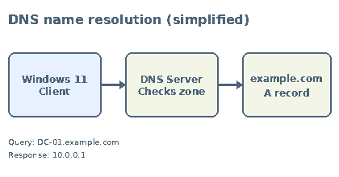

# Lab 51: DNS Fundamentals and Forward Lookup Zones

## 🎯 Objective

Understand the Domain Name System (DNS), its role in Active Directory Domain Services (AD DS), the DNS namespace and zone structure, and the purpose of common DNS resource records. This theory section establishes the concepts required before inspecting and working with a Forward Lookup Zone in the practical portion of this lab.

## 🖥️ Lab Environment

- 🖥️ **Hypervisor:** VMware Workstation
- 🏢 **Operating System:** Windows Server 2022
- 🌐 **Active Directory Domain:** `example.com`
- 🖥️ **Domain Controller:** `DC-01`
- 💻 **Client:** Windows 11
- 🧰 **Topics:** DNS name resolution, DNS hierarchy, Forward Lookup Zones, resource records, Dynamic DNS, and Active Directory-integrated DNS

## 📚 Theory — Understanding DNS

### 1. What Is DNS?

The **Domain Name System (DNS)** is a hierarchical and distributed naming system that translates domain names and hostnames into IP addresses. Computers use IP addresses to communicate across IP networks, while people and applications commonly use names that are easier to remember.

DNS provides the mapping between these names and network addresses. For example, a client that needs to contact `DC-01.example.com` can query DNS to discover the IP address associated with that hostname.

DNS is not a single central database. Its information is distributed across DNS servers and organized into a hierarchy of namespaces, zones, and resource records.

### 2. Why DNS Is Important in Active Directory

DNS is a core service dependency for Active Directory. Domain-joined Windows computers use DNS to locate domain controllers and the services those domain controllers provide.

When a Windows client joins `example.com`, it needs to discover a suitable domain controller. Active Directory publishes service-location records, known as **SRV records**, in DNS. These records help clients locate services such as LDAP and Kerberos.

DNS supports Active Directory operations including:

- **Domain controller discovery:** Locating an available domain controller for a domain.
- **LDAP:** Locating directory services used to query and manage directory information.
- **Kerberos:** Locating services involved in domain authentication.
- **Global Catalog discovery:** Locating Global Catalog servers when required.
- **Domain controller communication:** Resolving the names of other domain controllers and services.

For example, a client can query the SRV record:

```text
_ldap._tcp.dc._msdcs.example.com
```

This record identifies domain controllers offering LDAP services for the domain. The exact records registered depend on the domain and the services available.

**Important:** A domain controller can be running AD DS correctly while DNS problems prevent clients from locating it. Incorrect DNS configuration can therefore cause domain-join, logon, authentication, and directory-service discovery problems.

### 3. How DNS Name Resolution Works

DNS name resolution is the process of finding the information associated with a queried DNS name. In a typical Windows environment, the client sends a DNS query to the DNS server configured on its network adapter.

A simplified lookup for `DC-01.example.com` works as follows:

1. An application on the Windows client requests the address for `DC-01.example.com`.
2. The Windows DNS Client checks its local DNS cache for a usable answer.
3. If it does not have a cached answer, the client sends a query to its configured DNS server.
4. The DNS server checks the zones and records for which it is authoritative. If it can answer the query, it returns the matching record.
5. If the DNS server does not have the answer locally, it may use its cache, forwarders, or the DNS hierarchy to resolve the name, depending on its configuration.
6. The DNS response is returned to the client, and the client can use the resulting IP address to communicate with the destination.

The following diagram illustrates a simplified lookup in which the DNS server already hosts the relevant zone and record.



**Recursive and iterative queries**

- **Recursive query:** The client asks its configured DNS server to provide a final answer or an error. The client generally relies on that DNS server to perform any additional resolution required.
- **Iterative query:** A DNS server can receive a referral to another DNS server that is closer to the answer. It can then query that server and continue the resolution process.

**DNS caching and TTL**

DNS responses can be cached to reduce repeated queries and improve response time. A record's **Time to Live (TTL)** specifies how long a DNS resolver may cache that record before it should query again. A cached answer can therefore remain in use until its TTL expires, unless the cache is cleared or otherwise updated.

### 4. DNS Namespace and Hierarchy

DNS names are arranged in a hierarchical namespace. The hierarchy begins at the root, represented by a dot (`.`), and branches into top-level domains, registered domain names, and subordinate names.

For example:

```text
.
└── com
    └── example
        └── DC-01
```

- **Root domain (`.`):** The top of the DNS namespace.
- **Top-Level Domain (TLD):** A domain directly below the root, such as `com`, `org`, or `in`.
- **Second-Level Domain:** A name registered beneath a TLD, such as `example.com`.
- **Subdomain:** A domain created beneath another domain, such as `sales.example.com`.
- **Host name:** The name assigned to an individual host within a DNS namespace, such as `DC-01`.

A **Fully Qualified Domain Name (FQDN)** identifies a host or domain by its complete name in the DNS hierarchy. In this lab, `DC-01.example.com` is the FQDN used to identify the domain controller.

### 5. DNS Domain and DNS Zone

A DNS **domain** is a branch of the DNS namespace. A DNS **zone** is an administratively managed portion of that namespace for which a DNS server maintains authoritative DNS data.

A zone can contain records for its domain and, depending on the design, may delegate subdomains to separate zones. Therefore, a DNS domain and a DNS zone are related concepts, but they are not interchangeable.

For this lab, `example.com` is the domain namespace, and the practical exercise will inspect the Forward Lookup Zone named `example.com`.

### 6. Forward Lookup Zone

A **Forward Lookup Zone** contains DNS records used to resolve names into IP addresses or other DNS information. The most familiar forward lookup is an A record, which maps a host name to an IPv4 address. An AAAA record performs the corresponding mapping for IPv6.

For example:

| Name | Record type | Example value |
|---|---|---|
| `DC-01` | A | `10.0.0.1` |
| `server6` | AAAA | IPv6 address |

When a client queries for `DC-01.example.com`, the DNS server can look in the `example.com` Forward Lookup Zone and return the matching A record if one exists.

A Forward Lookup Zone can also contain records that provide service-location, mail-routing, alias, and zone-authority information.

```text
DNS hierarchy (from right to left)

.                         Root
└── com                   Top-Level Domain
    └── example           Second-Level Domain
        └── DC-01         Host name

FQDN: DC-01.example.com

The example.com Forward Lookup Zone can contain the
A record that maps DC-01 to 10.0.0.1.
```

### 7. DNS Resource Records

DNS information is stored as **resource records (RRs)**. Each record contains information such as a name, record type, time to live, and record-specific data.

The following records are important to understand before working with DNS Manager:

| Record | Purpose | Example / use |
|---|---|---|
| **A** | Maps a host name to an IPv4 address. | `DC-01.example.com → 10.0.0.1` |
| **AAAA** | Maps a host name to an IPv6 address. | Associates a host with its IPv6 address. |
| **CNAME** | Creates an alias that points to another canonical DNS name. | `files.example.com → server01.example.com` |
| **MX** | Identifies mail servers responsible for receiving email for a domain. | Specifies a mail exchanger and its priority. |
| **NS** | Identifies the authoritative name servers for a DNS zone. | Lists the name servers for `example.com`. |
| **SOA** | Stores key administrative information about a DNS zone. | Identifies the primary source for the zone's authority data and includes serial and timing values. |
| **PTR** | Maps an IP address back to a DNS name in a reverse lookup zone. | `10.0.0.1 → DC-01.example.com`. |
| **SRV** | Identifies the host and port for a service. | Helps Active Directory clients locate LDAP and Kerberos services. |

**Record details**

- **A and AAAA:** These are address records. A is for IPv4; AAAA is for IPv6.
- **CNAME:** An alias points to another DNS name, not directly to an IP address. A CNAME owner name should not also contain other ordinary data records.
- **MX:** Mail systems use MX records to find the mail servers for a domain. The preference value helps determine which mail server is preferred.
- **NS:** NS records identify the name servers authoritative for a zone.
- **SOA:** Every standard DNS zone has an SOA record. It contains the zone serial number and timing parameters used in zone maintenance and transfers.
- **PTR:** PTR records are normally stored in a Reverse Lookup Zone. They are included here for comparison; reverse lookup configuration is covered separately in Lab 52.
- **SRV:** SRV records are particularly important in Active Directory because they advertise the location of domain services.

### 8. Dynamic DNS (DDNS)

**Dynamic DNS (DDNS)** allows DNS records to be updated dynamically rather than requiring every address change to be entered manually by an administrator.

In a Windows domain environment, domain controllers and domain-joined computers can register and update their DNS records. This helps keep DNS information aligned with the names and addresses used by the systems.

For example, when a domain controller starts or its relevant network configuration changes, it can register the DNS records required for clients to locate its services.

Dynamic updates can be configured as:

- **Nonsecure and secure dynamic updates:** Allows updates without requiring the DNS update to be authenticated. This is generally unsuitable for an Active Directory-integrated zone in a domain environment.
- **Secure only:** Requires the update to be authenticated and authorized. This is commonly used with Active Directory-integrated DNS zones.

The update behavior depends on the zone type and its configured dynamic update policy.

### 9. Active Directory-Integrated DNS

A DNS zone can be stored in a file or integrated into Active Directory. An **Active Directory-integrated DNS zone** stores its zone data in the directory database rather than in a traditional standalone zone file.

This integration provides several benefits:

- **Directory-based storage:** DNS zone data is stored as Active Directory objects.
- **Replication:** DNS data can replicate through Active Directory replication.
- **Replication scope choices:** Administrators can choose an appropriate scope, such as replication to DNS servers in the domain or across the forest, depending on the zone and partition configuration.
- **Secure dynamic updates:** The zone can use Active Directory security permissions to control who is allowed to update DNS records.
- **Multi-master updates:** DNS-enabled domain controllers that host the AD-integrated zone can accept updates, which are then replicated through Active Directory.

Active Directory-integrated DNS commonly uses the following application directory partitions:

- **DomainDnsZones:** DNS application data intended for DNS servers in the relevant domain.
- **ForestDnsZones:** DNS application data intended for DNS servers across the forest.

These partitions were inspected in **Lab 50 — Active Directory Partitions**. Their replication scope determines which DNS-enabled domain controllers receive the relevant application data.

### 10. DNS Server Components and Resolution Sources

A Windows DNS server can use several sources when resolving a query:

- **Authoritative zone data:** Records hosted in a zone for which the DNS server is authoritative.
- **Cache:** Previously resolved DNS information that remains valid according to its TTL.
- **Forwarders:** DNS servers to which queries can be forwarded for resolution.
- **Root hints:** Information about root DNS servers that can help a DNS server begin iterative resolution when it does not have another configured path to the answer.

These mechanisms help DNS servers resolve both internal names and names outside the local DNS zones. The actual resolution path depends on the DNS server configuration and the query.

## 🧠 Important Concepts to Remember

- DNS translates names into network-related information, including IP addresses.
- Active Directory relies on DNS to locate domain controllers and directory services.
- SRV records help clients discover services such as LDAP and Kerberos.
- A DNS domain is part of the namespace; a DNS zone is an administratively managed portion of that namespace.
- A Forward Lookup Zone is used to resolve names, commonly to IPv4 or IPv6 addresses.
- A records are used for IPv4; AAAA records are used for IPv6.
- PTR records are used for reverse lookup and will be explored in Lab 52.
- TTL controls how long DNS information may be cached.
- Dynamic DNS allows eligible systems to register and update records.
- Active Directory-integrated zones store DNS data in AD DS and replicate according to the selected application partition scope.

## 🛠️ Practical — Creating and Verifying a DNS Host (A) Record

In this exercise, a Host (A) record is created in the existing `example.com` Forward Lookup Zone for the Windows 11 client. The record maps the client hostname to its IPv4 address.

### 1. Open DNS Manager on DC-01

1. Sign in to `DC-01`.
2. Open **Server Manager → Tools → DNS**.
3. Expand the `DC-01` DNS server.
4. Expand **Forward Lookup Zones**.
5. Select the `example.com` zone.

**📸 Screenshot — example.com Forward Lookup Zone in DNS Manager**

.png)

### 2. Create the Host (A) Record

1. Right-click the `example.com` Forward Lookup Zone.
2. Select **New Host (A or AAAA)**.
3. Enter the following details:

| Field | Value |
|---|---|
| Host name | `CLIENT-01` |
| IP address | `10.0.0.10` |
| Record type | A (IPv4) |

4. Click **Add Host**.
5. After the record is added, click **OK** to close the confirmation message.

The new record should appear in the `example.com` zone with the hostname `CLIENT-01` and address `10.0.0.10`.

**📸 Screenshot — New Host (A) record configuration for CLIENT-01**

.png)
**📸 Screenshot — CLIENT-01 A record created in the example.com zone**

.png)

### 3. Verify DNS Resolution from Windows 11

On the Windows 11 client (`CLIENT-01`), open Command Prompt and run:

```cmd
nslookup CLIENT-01.example.com
```

The lookup returned the following information:

```text
Server:  10.0.0.1
Name:    CLIENT-01.example.com
Address: 10.0.0.10
```

This result confirms that the Windows 11 client queried the DNS server at `10.0.0.1` and that the fully qualified domain name `CLIENT-01.example.com` resolved to `10.0.0.10`.

### 4. Verify Name Resolution and Connectivity

From the same Windows 11 Command Prompt, run:

```cmd
ping CLIENT-01.example.com
```

The ping completed successfully. This confirms that the hostname resolved to the target address and that the target responded to ICMP echo requests.

**Verification note:** `nslookup` verifies DNS resolution. A successful ping additionally demonstrates that the resolved destination responds to ICMP; ping success is not, by itself, a complete test of every network service.

**📸 Screenshot — DNS resolution and successful ping from Windows 11**

.png)

## 🎯 Expected Result

After completing this lab, the reader should be able to:

- Explain DNS and its importance to Active Directory.
- Describe the basic DNS name-resolution process.
- Distinguish recursive and iterative queries.
- Explain DNS caching and TTL.
- Understand the DNS namespace hierarchy and FQDNs.
- Distinguish a DNS domain from a DNS zone.
- Explain the purpose of a Forward Lookup Zone.
- Identify common DNS resource records, including A, AAAA, CNAME, MX, NS, SOA, PTR, and SRV.
- Explain Dynamic DNS and secure dynamic updates.
- Describe how Active Directory-integrated DNS zones store and replicate DNS data.

## 🌍 Real-World Use Case

In an organization, employees access domain resources using names rather than memorizing IP addresses. When a user signs in to a Windows domain, the client must locate a domain controller and the services needed for authentication. DNS provides the records that make this service discovery possible.

Administrators maintain DNS zones and records so that servers, applications, and clients can locate the correct systems. Active Directory-integrated DNS also helps keep domain-related records available across the intended DNS-enabled domain controllers through directory replication.

## 📌 Outcome

Studied DNS fundamentals and configured a Host (A) record in the `example.com` Forward Lookup Zone for `CLIENT-01`, mapping it to `10.0.0.10`. Verified the fully qualified domain name from Windows 11 using `nslookup` and confirmed successful ICMP connectivity using `ping`.

## 🙏 Acknowledgment

This theory section is part of my Active Directory homelab learning journey. Thanks for taking the time to review my documentation.

## ✍️ Author's Note

I completed the theory first and then applied the concepts by creating an A record for the Windows 11 client. The practical verification demonstrates how a DNS server resolves a fully qualified domain name to its associated IPv4 address.

## ✅ Closing

This lab combined DNS theory with a practical configuration exercise. After reviewing DNS name resolution, zones, resource records, Dynamic DNS, and Active Directory-integrated DNS, a Host (A) record was created for the Windows 11 client and successfully verified using `nslookup` and `ping`.

---
